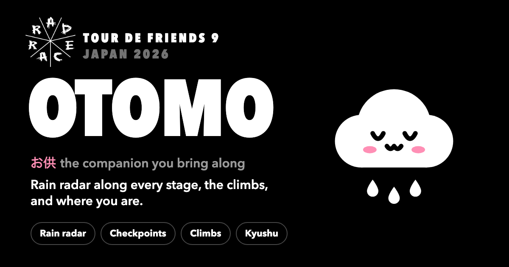

<p align="center">
  
</p>

<h1 align="center">Otomo お供</h1>

<p align="center">
  <strong>The companion app for Rad Race Tour de Friends 9 Japan.</strong><br>
  Rain radar along every stage, the climbs, and where you are.
</p>

<p align="center">
  <a href="https://peetzweg.github.io/otomo/"><strong>Open Otomo →</strong></a>
</p>

<p align="center">
  
</p>

In Japanese, *otomo* (お供) is the companion you bring along on a journey. This one rides along through
Kyushu for the four stages of the Tour de Friends, Fukuoka to Sakurajima, 3 to 6 November 2026. It's an
installable web app: open it in Safari or Chrome and add it to your Home Screen.

Made by a rider, for the riders. Not an official Rad Race app.

## What it does

- **Rain on your stage.** The Japan Meteorological Agency's own radar: 250 m, new every 5 minutes, the
  last 90 minutes and a forecast for the next hour. "Dry along the whole route", "Rain on 12 km ahead",
  "Rain reaching the route in ~20 min".
- **The elevation profile, coloured by the rain on it.** Scrub the timeline and watch the rain move
  over the climbs. Drag along the profile and a marker shows that point on the map.
- **Where you are.** With location on, your km, what's left to climb and the next checkpoint. Once
  you're on the route, the forecast only looks at the road ahead.
- **Checkpoints, dates and start times** for each stage, from the riders portal.
- **Weather along the route.** Tap the sun for the forecast at the start, checkpoints, top and finish,
  for the hour you'd get there (Open-Meteo, on JMA's models).
- **Map, topo and satellite.** Hillshading and contour lines are drawn in the browser from open
  elevation data; satellite is GSI's aerial photography of Japan.
- **Any spot, too.** Tap the pin to check the rain anywhere in Japan.

## No backend

Everything runs in the browser and the site is static (GitHub Pages). The phone talks directly to:

| What | From |
| --- | --- |
| Rain radar and nowcast | [気象庁 高解像度降水ナウキャスト](https://www.jma.go.jp/bosai/nowc/) (JMA), recoloured |
| Base map | [OpenFreeMap](https://openfreemap.org) (© OpenMapTiles, © OpenStreetMap contributors) |
| Elevation (hillshade, contours) | [Terrain Tiles on AWS](https://registry.opendata.aws/terrain-tiles/) |
| Aerial photos | [地理院タイル](https://maps.gsi.go.jp/development/ichiran.html) (GSI) |

The routes are bundled at build time from the public komoot collection, so komoot isn't contacted at runtime.

## How the radar works

See [src/radar/jma.ts](src/radar/jma.ts). In short:

- JMA's tiles allow cross-origin requests; its time lists don't, so the latest run is found by probing a
  tile on the fixed 5-minute grid.
- JMA only draws **even zooms (4, 6, 8, 10)**; odd zooms answer 200 with an empty placeholder, so odd
  tiles are cut from their parent.
- Once a new run is out, the previous run's forecast loses its detailed zooms, so the probe checks z10.
- Every tile is an indexed PNG with JMA's 8-step scale: recolouring is a palette swap, and a pixel's
  colour is an intensity class. That's how the app reads rain at a point and along a route.

## Stages

The routes come from the komoot collection and the day's details from the riders portal:

```sh
node scripts/komoot.mjs 4767132   # routes and elevation → src/stages/stages.json
```

Dates, start times, official distances and checkpoints live in
[src/stages/schedule.ts](src/stages/schedule.ts).

## Develop

```sh
pnpm install
pnpm dev
scripts/og/render.sh   # the share image, public/og.png
```

Pushing to `main` deploys to GitHub Pages. Installed apps pick up a new version on their own: they
look for one on launch, hourly, and when brought back after 10+ minutes away, and swap it in at a
moment that feels like opening the app (see [src/pwa.ts](src/pwa.ts)). Long-press the otomo pill to
see which version a phone runs.
